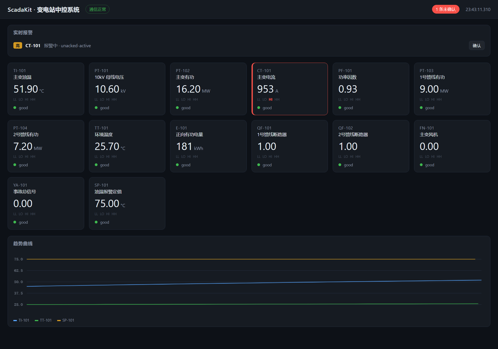

# ScadaKit

**一套能在一台电脑上跑通"下位机 → 通信 → 上位机 → 组态画面"整条链路的中控(SCADA)系统** ——
自写 Modbus 协议栈、点表引擎、实时库、ISA-18.2 报警状态机、趋势历史，外加一个内置的
Web 组态画面。C++17，零第三方依赖。

[](https://github.com/lcymxm/scadakit/actions/workflows/ci.yml)
[](LICENSE)

```
┌──────────────┐   Modbus TCP/RTU   ┌──────────────────────────────────────────┐
│  下位机 PLC   │◄──────────────────►│              上位机 (scadakit)            │
│              │                    │                                          │
│ 模拟变电站    │   coils / discrete │  主站 ──► 点表 ──► 实时库 ──► 报警引擎    │
│ 油温 电压 电流 │   input / holding  │   │                 │           │     │
│ 断路器 风机   │                    │   │                 ▼           ▼     │
└──────────────┘                    │   └──► 合并读取   趋势历史    Web HMI  │
                                    │                     (CSV)    :8080    │
                                    └──────────────────────────────────────────┘
```



上图是真实的运行截图：模拟变电站的电流越了 900 A 的高限，卡片描红、`HI` 标记点亮、顶部
报警条出现"1 条未确认"，趋势曲线按工程单位分组显示（°C 组三条：油温、环境温度、定值）。

## 为什么写这个

电气工程及其自动化专业里，"中控系统"几乎是绕不开的：变电站综合自动化、水厂/泵站集控、
产线监控，本质都是**下位机采集 + 上位机监视**。但课本讲原理、现场看厂家软件，中间那层
"协议怎么编解码、点表怎么映射、报警怎么管、画面怎么刷新"往往没人拆开给你看。

这个项目把那层拆开了，而且拆得足够完整：没有 PLC 也能跑，因为下位机是这个仓库自带的模拟器；
不装任何库也能编，因为协议、套接字、HTTP、JSON 全是手写的。

## 能做什么

| 模块 | 说明 |
|------|------|
| Modbus 协议栈 | CRC-16/MODBUS、PDU 编解码、MBAP（TCP）与 RTU 两种帧、异常码、位/寄存器两种数据 |
| 跨平台套接字 | Windows winsock2 / POSIX 双实现，带连接超时与读超时，单头文件接口不泄漏平台类型 |
| Modbus 主站 | 超时、重试、断线重连、事务号校验，支持 RTU over TCP |
| Modbus 从站 | 四张数据表齐全（coil / discrete input / input register / holding register），多客户端并发，纯函数式请求处理便于单测 |
| 下位机模拟器 | 一个会自己演化的变电站：负荷按日周期变化，油温一阶惯性滞后，风机按定值启停，电量累计 |
| 点表引擎 | 名字 → 寄存器映射，六种数据类型，增益/偏移换算，五位数地址（40001/30001/00001/10001）与传统写法都认 |
| 实时库 | 数值 + 质量码（good/uncertain/bad/stale/comm-failure）+ 时标，变化死区过滤 |
| 报警引擎 | ISA-18.2 四态状态机（未确认/已确认/已恢复未确认/正常），HH/HI/LO/LL 四级，回差、确认、SOE 事件流 |
| 趋势历史 | 变化存储 + 周期存储，环形缓冲，CSV 导出 |
| 合并读取 | 把相邻的寄存器合成一次请求，125 寄存器上限自动分块 |
| Web HMI | 内置 HTTP 服务器 + 单页组态画面（SVG/CSS/原生 JS，无框架），带趋势曲线与报警确认 |
| CLI | `simulate` / `run` / `probe` 三个子命令 |

## 快速开始

需要 CMake ≥ 3.16 和一个 C++17 编译器，别的什么都不用装。

```bash
cmake -S . -B build -DCMAKE_BUILD_TYPE=Release
cmake --build build --parallel
```

开三个终端：

```bash
# 1. 下位机：模拟变电站，Modbus TCP 从站
./build/scadakit simulate --port 1502

# 2. 上位机：采集 + 报警 + Web HMI
./build/scadakit run --tags config/example.tags --port 1502 --web-port 8080

# 3. 看画面
#    浏览器打开 http://127.0.0.1:8080/
```

想先确认链路通不通，用 `probe` 读一次就退出：

```
$ ./build/scadakit probe --tags config/example.tags --port 1502
tag          description                       value unit  quality    alarm
--------------------------------------------------------------------------------
TI-101       主变油温                         45.000 °C    OK         normal
PT-101       10kV 母线电压                    10.500 kV    OK         normal
PT-102       主变有功                         14.500 MW    OK         normal
CT-101       主变电流                        861.900 A     OK         normal
PF-101       功率因数                          0.930       OK         normal
PT-103       1号馈线有功                       8.000 MW    OK         normal
PT-104       2号馈线有功                       6.600 MW    OK         normal
TT-101       环境温度                         25.000 °C    OK         normal
E-101        正向有功电量                      0.200 kWh   OK         normal
QF-101       1号馈线断路器                     1.000       OK         normal
QF-102       2号馈线断路器                     1.000       OK         normal
FN-101       主变风机                          0.000       OK         normal
YA-101       事故总信号                        0.000       OK         normal
SP-101       油温报警定值                     75.000 °C    OK         normal
```

**把模拟器关掉再看 HMI** —— 所有点会在一秒内变灰、标注 `comm-failure`，顶部状态灯从
"通信正常"变成"通信中断"。这就是 SCADA 里最要紧的一件事：**数值不可信时要让操作员看出来，
而不是继续显示最后一个数**。

## 下位机寄存器表

`src/plant.cpp` 里的模拟变电站，点表配置与之对应：

| 表 | 地址（偏移） | 含义 | 类型 | 倍率 |
|----|-------------|------|------|------|
| 输入寄存器 3x | 0 | 主变油温 | int16 | ×0.1 °C |
| | 1 | 母线电压 | int16 | ×0.1 kV |
| | 2 | 主变有功 | int16 | ×0.1 MW |
| | 3 | 主变电流 | int16 | ×0.1 A |
| | 4 | 功率因数 | int16 | ×0.01 |
| | 5 / 6 | 1号 / 2号馈线有功 | int16 | ×0.1 MW |
| | 7 | 环境温度 | int16 | ×0.1 °C |
| | 8–9 | 正向有功电量 | uint32（高字在前） | ×0.1 kWh |
| 保持寄存器 4x | 0 | 油温报警定值 | int16 | ×0.1 °C |
| | 1 / 2 | 电压上/下限 | int16 | ×0.1 kV |
| 线圈 0x | 0 / 1 | 1号 / 2号馈线遥控合闸 | bit | — |
| 离散输入 1x | 0 / 1 | 馈线断路器合位 | bit | — |
| | 2 | 主变风机运行 | bit | — |
| | 3 | 事故总信号 | bit | — |

过程模型不复杂但也不是死数：负荷按 10 分钟周期正弦变化，油温是一阶惯性环节追
`环境温度 + 6 + 负荷×1.6`（时间常数 45 秒），所以**油温曲线会滞后于功率曲线** ——
这正是值班员看趋势时关心的那种关系。

## 点表配置

```ini
[tag:TI-101]
description = 主变油温
unit = °C
station = 1
register = 30001          # 等价于 input:0
type = int16
gain = 0.1                # 工程值 = 原始值 × gain + offset
deadband = 0.2            # 变化小于此值不入库
alarm-deadband = 1.5      # 报警回差
hi = 58
hihi = 65
lo = 5
lolo = 0
```

- `register` 两种写法：`input:0` / `holding:0` / `coil:0` / `discrete:0`，或传统五位数
  `30001` / `40001` / `00001` / `10001`。
- `type`：`int16` `uint16` `int32` `uint32` `float32` `bit`。32 位量占两个寄存器，**高字在前**
  （Modbus 的默认字序）。`coil` 和 `discrete` 只能是 `bit`，反之寄存器不能是 `bit`。
- 配置写错会带着行号报错，比如 `line 12: unknown key 'colour'`。

## 报警：为什么不是一个 bool

真实中控系统里，"报警"至少有三个独立的问题要分开：**条件还在不在**、**操作员看过没有**、
**谁先谁后**。所以这里按 ISA-18.2 的思路做成了四态机：

```
                  条件成立                    确认
      Normal ───────────────► UnackedActive ─────────► AckedActive
        ▲                         │                       │
        │ 确认                    │ 条件消失               │ 条件消失
        │                         ▼                       │
        └──── UnackedReturned ◄────┘ ◄─────────────────────┘
```

- **回差（deadband）**：值要回到 `定值 ± 回差` 之外才算恢复，否则停在定值上的值会每个扫描周期抖动一次。
- **未确认就恢复**：不会静默变正常，而是留在 `UnackedReturned`，等操作员确认 —— 否则
  "刚刚响过的报警自己消失了"是最容易被漏掉的一类问题。
- **坏质量不参与判断**：设备断了不能凭空产生报警，也不能凭空清除已有的报警。

四个定值各自独立成一条报警：油温 90 °C 时 `HH` 和 `HI` 会同时挂出来。

## HTTP 接口

| 方法 | 路径 | 说明 |
|------|------|------|
| GET | `/` | 组态画面 |
| GET | `/api/snapshot` | 全部点的值、质量、时标、报警状态 |
| GET | `/api/alarms` | 当前报警列表 + 最近 20 条事件 |
| GET | `/api/history?tag=TI-101` | 某个点的趋势序列 `[[时间戳, 值], ...]` |
| POST | `/api/ack?tag=TI-101` | 确认该点的报警 |

```json
{
  "time": 1792596791662,
  "online": true,
  "polls": 21,
  "unacked": 0,
  "error": "",
  "tags": [
    {"name": "TI-101", "description": "主变油温", "unit": "°C",
     "value": 46.400, "quality": "good", "timestamp": 1792596791494,
     "alarm": "normal", "limits": [1, 1, 1, 1], "active": [0, 0, 0, 0]}
  ]
}
```

`limits` 是 `[LL, LO, HI, HH]` 四段定值**是否配置**，`active` 是**当前是否报警中**。
画面把两者分开用：配置了的定值画成灰色，报警中的那一段才标红 —— 混在一起会让每个配了定值
的点看起来都在报警。

## 设计取舍

**为什么自己写 Modbus。** 用 libmodbus 当然更快，但那样这个项目里最值得看的部分就被藏起来了。
协议本身并不长：PDU 五个字节，CRC 一个查表，MBAP 七个字节头。自己写的好处是它变成可以在
单测里逐字节验证的东西 —— 比如 `wrap_mbap` 后面接 `unwrap_mbap` 必须原样还原，RTU 帧翻一个
bit 必须被 CRC 拒掉，这些测试比读文档更能确认理解是对的。

**为什么套接字用整数句柄。** `include/scada/socket.hpp` 里没有 `<winsock2.h>`，也没有
`<sys/socket.h>`。句柄存成 `std::uintptr_t`，平台差异全压在 `socket.cpp` 一个文件里，
剩下的模块在 Windows 和 Linux 上编译的是同一份代码。

**为什么下位机从站支持多客户端。** 严格按现场习惯，一个 PLC 往往只允许一条连接。但那样
"网关占着连接时 probe 就进不去"会让人很难调试。这里每个连接独立缓冲，谁的帧先到齐先服务谁。

**为什么趋势要周期存。** 只做"变化存储"的话，电压这类变化缓慢的量在画面上几乎没有点，
曲线看起来像坏了。真实历史库都是**变化存储 + 周期存储**：值变了立刻存，没变也至少每 2 秒
存一个点。

**为什么 HTTP 是单线程的。** 组态画面一秒轮询一次，一个值班室的画面并发量远到不了需要线程池
的程度。单线程 + 每连接一次请求，代码量小一个数量级，也就没有并发 bug。真正并发的是
**采集线程和 HTTP 线程之间的数据访问**，这部分用一把锁保护，并且把扫描拆成"网络阶段（不持锁）"
和"更新阶段（持锁）"两段 —— 设备掉线时读超时最长 1 秒，不能把这 1 秒压在画面刷新上。

## 测试

```bash
ctest --test-dir build --output-on-failure
```

67 条单元/集成测试，覆盖：

- **协议编解码**：CRC-16/MODBUS 标准校验值 `0x4B37`、MBAP/RTU 往返、位序（低位在前，这个最容易写反）、
  异常响应、字节数不符要拒绝。
- **从站逻辑**：越界地址回 `0x02`、未知功能码回 `0x01`、非法线圈值回 `0x03`、写线圈回显。
- **真实套接字**：起一个从站线程，用主站连上去读，验证数值能原样传回；连接不存在的端口要报错而不是挂住。
- **点表**：五位数地址映射、32 位字序、float32 解码、增益偏移、重复名/未知键/缺寄存器要报错。
- **报警状态机**：四个状态的每条转移、回差、坏质量不参与、未确认恢复要留痕、严重度排序。
- **合并读取**：相邻合并、跳空合并、超 125 自动分块、不同表/不同站不能合并。
- **端到端**：模拟器 + 网关 + JSON 快照，以及设备不存在时全部点变 `comm-failure`。

其中 `Gateway.NeverAsksForMoreThan125Registers` 这条测试抓到了一个真 bug：块规划时把
*结束偏移*当成了*长度*，导致从 8 号寄存器起的读请求要了 10 个寄存器，越界后设备返回
`IllegalDataAddress`，于是那个点永远读不到。测试先红后绿，代码里的注释就是为了记住这件事。

## 已知局限

- **只做 Modbus。** 现场还有 IEC 60870-5-104（远动规约）、IEC 61850、OPC UA，各有各的模型，
  这个项目没做。
- **没有实时性保证**。轮询间隔是 `sleep` 出来的，不是 RTOS 的周期任务，也没有优先级和看门狗。
  真实现场用这个精度是不够的。
- **没有持久化**。报警记录和趋势都在内存里，进程一退就没了（趋势可以手动导出 CSV）。
  真实系统要写时序库或关系库。
- **没有身份认证**。HTTP 接口是裸的，`/api/ack` 谁都能调。默认还只绑 `127.0.0.1`，
  就是为了别把这种接口放到网上。要做成可远程访问的，至少得加认证和 HTTPS。
- **单主站**。一个网关只连一台设备（同一 host:port），多设备要起多个实例。
- **报警只有限值报警**，没有变化率报警、偏差报警、工况报警。

## 项目结构

```
scadakit/
├── CMakeLists.txt
├── include/scada/
│   ├── types.hpp        质量码、时标
│   ├── modbus.hpp       CRC / PDU / MBAP / RTU
│   ├── socket.hpp       跨平台 TCP（句柄成整数，不泄漏平台头文件）
│   ├── master.hpp       Modbus 主站
│   ├── slave.hpp        从站 + 四张数据表 + 纯函数 process_pdu
│   ├── plant.hpp        模拟变电站过程模型
│   ├── tag.hpp          点表、地址解析、类型解码
│   ├── rtdb.hpp         实时库
│   ├── alarm.hpp        ISA-18.2 报警状态机
│   ├── historian.hpp    趋势环形缓冲
│   ├── gateway.hpp      合并读取、扫描、JSON
│   ├── http.hpp         极简 HTTP/1.1 服务器
│   └── dashboard.hpp    内置组态画面
├── src/                 对应实现 + main.cpp
├── tests/               单元测试与端到端测试（自带极简测试框架）
├── config/example.tags  示例点表
└── .github/workflows/   CI
```

## 协议参考

- Modbus Application Protocol Specification V1.1b3
- Modbus over Serial Line Specification V1.02
- ISA-18.2 / IEC 62682，报警系统人机界面设计

## License

MIT，见 [LICENSE](LICENSE)。
